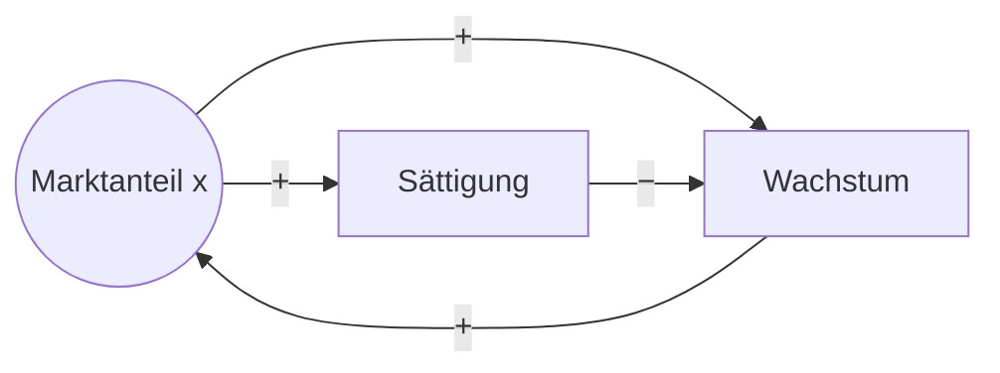

<Bifurkation plain />

# Chaostheorie in der Unternehmensführung

## Rückkopplungen, Synchronisation und die Zeitschere

Benötigte vs. verfügbare Reaktionszeit

Master Systems Engineering · Unternehmensführung 
Name · Datum

<!--
Cliffhanger: Das Muster im Hintergrund nicht erklären. Nur ein Satz: „Dieses Bild ist Ihre Jahresplanung. In 30 Minuten können Sie es lesen.“ Auflösung auf der Folie mit dem Bifurkationsdiagramm.
Einstieg mit einer Frage ans Publikum: Wie lange dauert es in eurem Unternehmen von einem Marktsignal bis zur umgesetzten Entscheidung? Und wie lange hat der Markt gewartet?
-->

---
class: text-sm
zoom: 0.88
---

# Ausgangspunkt: Drei Perioden der Unternehmensführung

| | Stabiles Wachstum | Wettbewerb | Hyperwettbewerb |
|---|---|---|---|
| **Zeitraum** | 1945 – Mitte 70er | Mitte 70er – Mitte 90er | seit Mitte 90er |
| **Umfeld** | Wachstum, Chancen | Wettbewerb, zyklisches Wachstum | rapide, nicht-lineare Veränderungen |
| **Ziele** | Umsatzwachstum, Risikostreuung | Überleben, Profitabilität | Management des Unvorhersehbaren |
| **Strategien** | Expansion | Kerngeschäft, Restrukturierung, Nischen, M&A | Neudefinition von Branche und Unternehmen, Partner |
| **Modelle** | Ansoff, Lebenszyklus, BCG | Porter, Kernkompetenzen, BPR | Chaostheorie, Spieltheorie, Industry Breakpoints |

**Leitfrage:** Warum wird gerade im Hyperwettbewerb die Chaostheorie zum Managementmodell – und was hat das mit **Reaktionszeit** zu tun?

Quelle: Vorlesungsfolie Unternehmensführung, Hochschule Landshut

<!--
Folie aus der Vorlesung. Unten rechts steht die Chaostheorie als Managementmodell des Hyperwettbewerbs. Auffällig: Die Umfeldbeschreibung wandert von "Wachstum" über "zyklisch" zu "nicht-linear" – genau diese drei Stufen werden wir gleich in einer einzigen Gleichung wiederfinden.
-->

---

# Agenda

1. Die Zeitschere: benötigte vs. verfügbare Reaktionszeit
2. Chaostheorie: Rückkopplungen und Prognosegrenzen
3. Die logistische Gleichung – drei Perioden in einer Formel
4. Synchronisation
5. Fallbeispiel: Halbleiterkrise 2020–2023
6. Handlungsempfehlungen, Grenzen und Fazit

---
layout: section
---

# 1 · Die Zeitschere

---
layout: two-cols-header
class: text-sm
zoom: 0.9
---

# Die Zeitschere

::left::

**Verfügbare Reaktionszeit** $T_V$ 
vom ersten erkennbaren Signal bis zum *Point of no Return* 
↓ sinkt mit steigender **Dynamik**

**Benötigte Reaktionszeit** $T_B$ 
Wahrnehmen + Warten + Entscheiden + Umsetzen + Wirken 
↑ steigt mit steigender **Komplexität**

Gilt $T_B > T_V$, reagiert das Unternehmen auf eine Lage, **die es nicht mehr gibt**.

::right::

<Zeitschere />

<!--
Zeitschere v. a. nach Bleicher (Integriertes Management): Dynamik verkürzt die verfügbare Zeit, Komplexität verlängert die benötigte. Die Grafik ist schematisch – der Schnittpunkt im Übergang zum Hyperwettbewerb ist unsere These, keine Messung.
-->

---
class: text-sm
---

# Anatomie der benötigten Reaktionszeit

$$
T_B = T_{\text{Wahrnehmung}} + T_{\text{Warten}} + T_{\text{Entscheidung}} + T_{\text{Umsetzung}} + T_{\text{Wirkung}}
$$

| Komponente | Treiber | Beispiel |
|---|---|---|
| Wahrnehmung | Informationswege, Datenlage | Absatzeinbruch erst im Monatsreport sichtbar |
| **Warten** | Planungstakt $h$ – im Mittel $h/2$ | Jahresbudget → im Schnitt **6 Monate** Wartezeit |
| Entscheidung | Hierarchie, Abstimmungsschleifen | Freigabe durch Vorstand / Aufsichtsrat |
| Umsetzung | Architektur, Modularität | neue Produktionslinie, Lieferantenwechsel |
| Wirkung | Trägheit des Systems | Lieferzeiten, Markteinführung |

Die Wartezeit wird oft übersehen: Ein Signal, das zu einem zufälligen Zeitpunkt eintrifft, wartet im Mittel einen **halben Planungszyklus**, bevor es überhaupt in eine Entscheidung eingeht.

<!--
Wichtig für später: Der Planungstakt h taucht in der logistischen Gleichung direkt als Parameter wieder auf.
-->

---
layout: section
---

# 2 · Chaostheorie

Rückkopplungen und Prognosegrenzen

---

# Deterministisch ≠ vorhersagbar

Nichtlineare Systeme mit Rückkopplung reagieren **empfindlich auf Anfangsbedingungen** (Lorenz 1963, „Schmetterlingseffekt").

Ein kleiner Messfehler $\delta_0$ wächst exponentiell:

$$
\delta(t) \approx \delta_0 \, e^{\lambda t} \qquad \lambda = \text{Lyapunov-Exponent}
$$

Daraus folgt ein **Prognosehorizont**:

$$
T_P \approx \frac{1}{\lambda} \ln \frac{\Delta}{\delta_0}
$$

<v-clicks>

- 10× genauere Daten verlängern den Horizont nur um $\ln(10)/\lambda \approx 2{,}3/\lambda$
- Prognosegenauigkeit wirkt **logarithmisch**, eine kürzere Reaktionszeit wirkt **1 : 1**
- → Im chaotischen Umfeld ist **Reaktionsfähigkeit wertvoller als Vorhersagefähigkeit**

</v-clicks>

<!--
Kernargument Nr. 1: Die verfügbare Reaktionszeit ist im chaotischen System nicht nur knapp, sondern prinzipiell begrenzt. Mehr Daten kaufen kaum Zeit.
-->

---
class: text-sm
zoom: 0.9
---

# Rückkopplungen und Verzögerungen

- **Verstärkend (+):** Wachstum, Eskalation, Panik 
  Knappheit → Hamsterbestellungen → mehr Knappheit
- **Ausgleichend (−):** Regelung auf einen Sollwert 
  Lager, Kapazität, Preis

<v-clicks>

- **Verzögerung** in der ausgleichenden Schleife → Maßnahme trifft auf veränderte Lage → **Überschießen** → Schwingung
- \+ **Nichtlinearität** (Kapazitätsgrenzen, Sättigung) → **Chaos**
- Belege: Schweinezyklus (Hanau 1928), Beer Game (Forrester 1961, Sterman 1989), Chaos im Beer Game (Mosekilde, Larsen & Sterman 1991)

</v-clicks>

Die benötigte Reaktionszeit ist **die Verzögerung in der Regelschleife** – und damit selbst eine Ursache von Instabilität.

<!--
Kernargument Nr. 2: Langsame Reaktion ist nicht nur ineffizient, sie destabilisiert. Beer Game: Teilnehmer ignorieren die bereits bestellte, aber noch nicht gelieferte Ware – mit den Entscheidungsregeln realer Teilnehmer zeigt das Modell deterministisches Chaos.
-->

---
layout: section
---

# 3 · Die logistische Gleichung

Drei Perioden in einer Formel

---
layout: two-cols-header
class: text-sm
zoom: 0.9
---

# Die logistische Gleichung

::left::

**Stetig** (Verhulst 1838): $\;\dfrac{dx}{dt} = r \, x \, (1 - x)$

→ S-Kurve; ihre Ableitung ist die Absatzkurve des **Lebenszyklusmodells**

**Diskret** (May 1976): $\;x_{n+1} = R \, x_n \, (1 - x_n)$

- $x$: Marktdurchdringung / Auslastung (Obergrenze 1)
- $R \, x_n$: **verstärkende** Rückkopplung
- $(1 - x_n)$: **ausgleichende** Rückkopplung

Beide Rückkopplungsarten stecken in **einer einzigen Zeile**.

::right::

Oben: verstärkende Schleife · Unten: ausgleichende Schleife

<!--
Mund-zu-Mund-Propaganda oder Skaleneffekte als verstärkende Schleife; Sättigung, Konkurrenz oder Kapazitätsgrenze als ausgleichende Schleife.
-->

---

# Wo steckt die Reaktionszeit?

**Gedankenexperiment Kapazitätsplanung:** Der Markt wächst stetig mit Dynamik $r$. Das Unternehmen prüft seine Kapazität nur alle $h$ Zeiteinheiten und schreibt die beobachtete Wachstumsrate über den ganzen Zyklus fort:

$$
x_{n+1} = x_n + r h \; x_n (1 - x_n)
$$

Umskaliert mit $y = \frac{rh}{1 + rh} \, x$ ist das **exakt die logistische Abbildung** mit

$$
R = 1 + r \cdot h
$$

<v-clicks>

- $1/r$ = Eigenzeit des Marktes ≈ **verfügbare** Reaktionszeit
- $h$ = Planungs- bzw. Reaktionstakt ≈ **benötigte** Reaktionszeit
- $r \cdot h = h \,/\, (1/r)$ → $R$ misst die **Zeitschere**

</v-clicks>

Die stetige Gleichung ist immer stabil. Zyklen und Chaos entstehen erst durch den Reaktionstakt $h$ – **das Chaos steckt in der Steuerung, nicht im Markt.**

<!--
Herleitung für Rückfragen: x(n+1) = (1+a) x − a x² mit a = rh. Setze y = a x / (1+a), dann folgt y(n+1) = (1+a) y (1 − y). Also R = 1 + a.
Ein eindimensionales stetiges System kann weder schwingen noch chaotisch werden – die Instabilität kommt allein aus der Diskretisierung, also aus der Reaktion in Takten.
-->

---
class: text-sm
---

# Gleiche Organisation, steigende Dynamik

Jahresplanung ($h$ = 1 Jahr), Start bei 10 %, Ziel 100 % des Marktpotenzials – nur die Marktdynamik $r$ steigt:

| $r \cdot h$ | $R$ | Kapazität in % des Potenzials je Planungszyklus\* | Verhalten |
|---|---|---|---|
| 0,5 | 1,5 | 10 → 15 → 21 → 29 → 39 → 51 → 64 → 75 → 84 → 91 → 95 | glatte Annäherung |
| 1,0 | 2,0 | 10 → 19 → 34 → 57 → 81 → 97 → 100 | schnell, ohne Überschießen |
| 1,8 | 2,8 | 10 → 26 → 61 → **104** → 97 → 102 → 98 → 102 → 99 | gedämpfte Schwingung |
| 2,3 | 3,3 | 10 → 31 → 80 → **117 → 71 → 118 → 68 → 118 → 69** | Dauerzyklus („Schweinezyklus") |
| 2,7 | 3,7 | 10 → 34 → 95 → 108 → 85 → 119 → 58 → 124 → 44 → 111 → 78 | **deterministisches Chaos** |

Die Organisation hat sich **nicht verändert** – nur das Umfeld ist dynamischer geworden. Werte über 100 % bedeuten Überkapazität.

* Werte aus eigener Simulation (Python)

<!--
Werte aus eigener Simulation (Python). Gleiche Entscheidungsregel, gleicher Takt – nur r steigt. Genau das beschreibt die Vorlesungsfolie: Das Umfeld wird schneller, die Planungsroutinen bleiben.
-->

---
class: text-sm
---

# Drei Bereiche der Gleichung = drei Perioden der Folie

| $R$ | Verhalten auf Dauer | $\lambda$ | Periode auf der Folie |
|---|---|---|---|
| < 1 | Aussterben → 0 | < 0 | Marktaustritt |
| 1 – 3 | stabiles Gleichgewicht $x^* = 1 - 1/R$ (z. B. 0,60 bei R = 2,5) | < 0 | **Stabiles Wachstum** – „Wachstum, Chancen" |
| 3 – 3,57 | Zyklen mit Periodenverdopplung 2 → 4 → 8 … (z. B. 0,51 ↔ 0,80 bei R = 3,2) | < 0 | **Wettbewerb** – „zyklisches Wachstum" |
| > 3,57 | deterministisches Chaos | +0,35 (3,7) bis +0,69 (4,0) | **Hyperwettbewerb** – „rapide, nicht-lineare Veränderungen" |

<v-clicks>

- **Chaostheorie** ≙ Verhalten im rechten Bereich
- **Industry Breakpoints** (Strebel 1992) ≙ **Bifurkationspunkte**, an denen das Verhalten qualitativ kippt
- **Spieltheorie** ≙ Kopplung der Akteure → Synchronisation (Abschnitt 4)

</v-clicks>

**Lebenszyklusmodell** (Spalte 1) und **Chaostheorie** (Spalte 3) sind dieselbe Gleichung – einmal stetig, einmal getaktet bei hohem $R$.

<!--
Auch die Unternehmensziele passen: Umsatzwachstum entlang der S-Kurve, Überleben in den Tälern der Zyklen, Management des Unvorhersehbaren im Chaos.
Wichtig: Das ist eine Analogie, kein empirischer Beweis.
-->

---
layout: two-cols-header
class: text-sm
zoom: 0.9
---

# Das Bifurkationsdiagramm als Bild der drei Perioden

::left::

<Bifurkation />

Langzeitwerte der logistischen Abbildung, je R-Wert nach 300 Einschwingschritten

::right::

<v-clicks>

- **Bifurkationspunkte** (gestrichelt): R = 3 · 3,45 · 3,54 · … · 3,57
- **These:** Die Dynamik $r$ stieg von Periode zu Periode, der Reaktionstakt $h$ vieler Unternehmen kaum (Jahresplanung, Hierarchie)
- → $R = 1 + r h$ wanderte **nach rechts** durch das Diagramm
- Zwei Auswege: $R$ senken (kürzerer Takt, Dämpfung) **oder** im Chaos robust werden

</v-clicks>

<!--
Rückgriff auf die Titelfolie: „Das ist das Bild aus dem Hintergrund am Anfang. Jetzt können Sie es lesen.“
Das Diagramm wird live im Browser berechnet (components/Bifurkation.vue). Bereiche wie in der Zeitschere-Grafik: grün bis R = 3, gelb bis 3,57, rot darüber. Bei R ≈ 3,83 ist das Ordnungsfenster (3er-Zyklus) als heller Streifen sichtbar.
-->

---
class: text-sm
---

# Live: Die Dynamik steigt, der Planungstakt bleibt

Jahresplanung ($h$ = 1), Start bei 10 % des Marktpotenzials – der Regler erhöht **nur die Marktdynamik** $r$:

<Oszillation />

<!--
Regler langsam nach rechts ziehen (oder ▶ für den automatischen Durchlauf):
- r·h ≤ 1 (R ≤ 2): glatte S-Kurve – das Lebenszyklusmodell.
- r·h ≈ 1,8: erstes Überschießen, gedämpfte Schwingung, aber immer noch stabil.
- r·h = 2 (R = 3): erste Bifurkation – die Schwingung klingt nicht mehr ab, Dauerzyklus (Schweinezyklus).
- r·h ≈ 2,45 und 2,54: 4er- und 8er-Zyklus.
- r·h ≈ 2,57 (R ≈ 3,57): deterministisches Chaos.
- r·h ≈ 2,83 kurz anhalten: Ordnungsfenster mit 3er-Zyklus mitten im Chaos.
Rechts wandert der Marker durch das Bifurkationsdiagramm, links sieht man dieselbe Stelle als Zeitreihe. Die Organisation (Regel, Takt, Startwert) ist in allen Fällen identisch.
-->

---
layout: two-cols-header
class: text-sm
---

# Schmetterlingseffekt und Prognosehorizont

::left::

**Zwei fast identische Startwerte** ($r h$ = 2,7)\*

| Planungszyklus | Abweichung |
|---|---|
| Start | 10,00 % vs. 10,01 % |
| nach 14 Zyklen | 11 Prozentpunkte |
| nach 18 Zyklen | 46 Prozentpunkte |

→ Langfristige Kapazitätsplanung wird **unmöglich**

::right::

**Prognosehorizont** bei $R = 4$ ($\lambda = \ln 2$: Fehler verdoppelt sich je Periode)

| Anfangsfehler | Perioden bis 10 Pp. Fehler |
|---|---|
| $10^{-3}$ | 6,6 |
| $10^{-4}$ | 10,0 |
| $10^{-5}$ | 13,3 |
| $10^{-6}$ | 16,6 |

→ **1000-mal genauere Daten** bringen nur **10 Perioden** mehr Vorlauf

* Werte aus eigener Simulation (Python) · rechte Tabelle rechnerisch aus λ = ln 2

<!--
Werte aus eigener Simulation. Jede Verzehnfachung der Datenqualität bringt nur ln(10)/ln(2) ≈ 3,3 Perioden.
-->

---
class: text-sm
---

# Reaktionszeit als Totzeit: Hutchinson (1948)

$$
\frac{dx}{dt} = r \, x(t) \, \bigl(1 - x(t - \tau)\bigr)
$$

Die Bremse wirkt erst nach der Verzögerung $\tau$ (**benötigte** Reaktionszeit); $1/r$ ist die Eigenzeit des Systems (**verfügbare** Reaktionszeit).

| $r \cdot \tau$ | Verhalten (Ziel 1,0, Start 0,5) |
|---|---|
| 0,3 | kein Überschießen |
| 0,8 | 11 % Überschießen, pendelt sich ein |
| 1,4 | 48 % Überschießen, pendelt sich ein |
| 1,7 | Dauerschwingung 0,33 … 1,94 |
| 2,0 | Dauerschwingung 0,07 … 2,90 (beinahe Kollaps) |

**Schwellen aus der Theorie**

- monoton bis $r\tau < 1/e \approx 0{,}37$
- stabil bis $r\tau < \pi/2 \approx 1{,}57$

**Faustregel:** $\;\tau < 1{,}57 \cdot \dfrac{1}{r}$

Sonst entsteht eine Dauerschwingung – auch bei vernünftiger Entscheidungsregel.

<!--
Kompakteste formale Fassung der Zeitschere. Einschränkung: Diese stetige Variante erzeugt Zyklen, aber kein Chaos – dafür braucht es diskrete Takte wie bei May.
-->

---
class: text-sm
zoom: 0.8
---

# Frühwarnsignale aus der Gleichung

### Critical Slowing Down

Schritte, bis eine Störung auf 10 % abgeklungen ist:

| $R$ | Schritte |
|---|---|
| 2,0 | 2 |
| 2,5 | 4 |
| 2,8 | 11 |
| 2,9 | 22 |
| 2,95 | 42 |

Längere Erholung nach Schocks = **Breakpoint naht** (Scheffer et al. 2009)

### Feigenbaum-Beschleunigung

Verdopplungen bei

R = 3 → 3,449 → 3,544 → 3,564 → 3,570

Die Abstände schrumpfen jeweils um Faktor **≈ 4,67** (Feigenbaum 1978)

→ Nach der ersten Zyklusverdopplung bleibt bis zum Chaos **kaum noch Spielraum**

### Ordnungsfenster

Bei R ≈ 3,83 entsteht mitten im Chaos ein stabiler 3er-Zyklus:

0,16 → 0,51 → 0,96 ($\lambda$ = −0,37)

→ Eine Ruhephase im Hyperwettbewerb ist **keine Rückkehr zur Stabilität**

Li & Yorke 1975: „Period Three Implies Chaos" – Ursprung des Begriffs „Chaos"

Frühwarnsignale **verlängern die verfügbare Reaktionszeit** – sie sind messbar, ohne dass man das System vorhersagen muss.

<!--
Critical Slowing Down: Am stabilen Punkt gilt f'(x*) = 2 − R. Nähert sich R der 3, geht der Betrag gegen 1 – Störungen klingen immer langsamer ab.
-->

---
layout: section
---

# 4 · Synchronisation

---
class: text-sm
---

# Synchronisation – zwei Gesichter

Gekoppelte Oszillatoren gleichen ihren Takt an, sobald die Kopplung stärker ist als die Unterschiede ihrer Eigentakte – Huygens' Pendeluhren 1665, Kuramoto-Modell. Selbst **chaotische** Systeme lassen sich synchronisieren (Pecora & Carroll 1990).

| | Konstruktiv | Destruktiv |
|---|---|---|
| **Intern** | Vertrieb, Produktion und Einkauf im gemeinsamen Takt (S&OP, gemeinsame Datenbasis) → keine Wartezeiten an Schnittstellen | Jede Abteilung reagiert auf die verzögerten Reaktionen der anderen → Bullwhip |
| **Extern** | Organisationstakt passt zum Markttakt („Clockspeed", Fine 1998) | Herdenverhalten: alle reagieren gleichzeitig auf dasselbe Signal → Schwankungen addieren sich (Millennium Bridge 2000, Schweinezyklus) |

<v-clicks>

- Asynchronität **kostet benötigte Reaktionszeit** (Signale warten auf den nächsten Zyklus)
- Gleichlauf mit allen Wettbewerbern **verkürzt die verfügbare Reaktionszeit** (alle konkurrieren gleichzeitig um knappe Ressourcen)
- Enge Kopplung an den Markt kann Prognose **ersetzen**: Wer schnell genug folgt, muss nicht vorhersagen

</v-clicks>

<!--
Millennium Bridge London, Juni 2000: Fußgänger passten ihren Schritt unbewusst an das seitliche Schwanken an – positive Rückkopplung durch Synchronisation, die Brücke wurde nach zwei Tagen gesperrt (Strogatz et al. 2005).
-->

---
class: text-sm
---

# Gekoppelte logistische Gleichungen

Zwei Einheiten – Wettbewerber, Geschäftsbereiche, Stufen einer Lieferkette – jede für sich chaotisch ($R = 3{,}9$). Jede orientiert sich zum Anteil $\varepsilon$ am Zustand der anderen:

$$
x_{n+1} = (1-\varepsilon)\, f(x_n) + \varepsilon\, f(y_n), \qquad y_{n+1} = (1-\varepsilon)\, f(y_n) + \varepsilon\, f(x_n)
$$

| Kopplung $\varepsilon$ | 0 | 0,10 | 0,15 | **0,20** | 0,30 | 0,40 |
|---|---|---|---|---|---|---|
| Ø-Abstand der Einheiten\* | 0,34 | 0,45 | 0,41 | **≈ 0** | ≈ 0 | ≈ 0 |

Synchronisation ab $\;\varepsilon > \dfrac{1 - e^{-\lambda}}{2} \approx 0{,}195\;$ (bei $R = 4$ erst ab 0,25)

<v-clicks>

- Beide bleiben chaotisch, bewegen sich aber **im Gleichschritt** – Synchronisation beseitigt nicht das Chaos, nur die **Reibung**
- **Je turbulenter das Umfeld** ($\lambda$ größer), **desto enger** muss die Abstimmung sein
- **Spieltheorie:** Wettbewerber, die sich stark aneinander orientieren, erleben Boom und Absturz **gemeinsam** – antizyklisches Handeln heißt, die Kopplung bewusst zu lockern

</v-clicks>

* Werte aus eigener Simulation (Python)

<!--
Werte aus eigener Simulation; die Schwelle 0,195 passt zur Theorie (lambda bei R = 3,9 ≈ 0,50).
-->

---
layout: section
---

# 5 · Fallbeispiel

Halbleiterkrise der Automobilindustrie 2020–2023

---
layout: two-cols-header
class: text-sm
zoom: 0.9
---

# Halbleiterkrise: Ablauf

::left::

<v-clicks>

1. **Frühjahr 2020:** Autohersteller stornieren wegen Corona Chip-Bestellungen; Foundries verlagern Kapazität in die boomende Unterhaltungselektronik 1
2. **2. Halbjahr 2020:** Autonachfrage erholt sich schneller als erwartet – die Kapazität ist vergeben 1
3. **2021:** Bandstillstände weltweit – AlixPartners: **210 Mrd. USD** Umsatzverlust, 7,7 Mio. Fahrzeuge weniger 2
4. **2023:** Speicherchips kippen in die **Überbestände** – Samsung: Betriebsgewinn Q1 −95 % 5

</v-clicks>

::right::

**Die Zeitschere**

$T_V$: Medianbestand kritischer Chips bei Abnehmern **unter 5 Tage** (2019: 40 Tage) 3

$T_B$: Lieferzeit normal **6–9 Wochen**, Automotive-Chips Juli 2021 **26,5 Wochen**; Gesamtmarkt Dez. 2021 **25,8 Wochen** 4

$T_B \gg T_V$ → Stillstand

1 TIME 2021; World Economic Forum 2021 · 2 AlixPartners, Pressemitteilung 23.09.2021 · 3 U.S. Department of Commerce, RFI-Ergebnisse 25.01.2022 · 4 Susquehanna Financial Group, zitiert nach Bloomberg 10.08. und 08.12.2021 · 5 CNBC 27.04.2023

<!--
Vollständige Quellenangaben auf der Folie "Quellen Fallbeispiel". Commerce-RFI: Antworten von über 150 Unternehmen, Medianbestand für die am schwersten beschaffbaren Chips. Susquehanna misst die Spanne zwischen Bestellung und Lieferung über den Chipmarkt hinweg.
-->

---
class: text-sm
---

# Analyse mit den drei Bausteinen

| Baustein | Beobachtung |
|---|---|
| **Verstärkende Rückkopplung** | Knappheit → Mehrfach- und Vorratsbestellungen → noch mehr Knappheit |
| **Verzögerung** | Bestellsignale wirken erst nach Monaten → Überschießen in Überbestände |
| **Destruktive Synchronisation** | Alle Hersteller stornieren gleichzeitig und bestellen gleichzeitig nach → Bullwhip |

**Gegenbeispiel Toyota:** Nach Fukushima 2011 verpflichtete ein Business-Continuity-Plan die Lieferanten, **2 bis 6 Monate** Chipbestand zu halten – je nach Lieferzeit. Toyota kam dadurch bis Mitte 2021 weitgehend ohne Kürzungen durch die Krise (Reuters, 09.03.2021).

→ **Puffer sind gespeicherte Reaktionszeit.** Toyota verzichtete bewusst auf etwas Just-in-time-Effizienz, um $T_V$ zu verlängern.

<!--
Grenze des Puffers: Im September 2021 kürzte auch Toyota die Produktion um 40 % (900.000 → 540.000 Fahrzeuge), als Lockdowns in Südostasien die Chipknappheit verschärften (Reuters/Nikkei, 19.08.2021). Der Puffer hat also Zeit gekauft, aber keine unbegrenzte.
-->

---
layout: section
---

# 6 · Handlungsempfehlungen

---
class: text-sm
zoom: 0.8
---

# Vier Hebel gegen die Zeitschere

### A · $T_B$ senken

- Kürzere Zyklen: rollierende Forecasts statt Jahresbudget (Hope & Fraser 2003), Quartals-OKR, Sprints
- Dezentrale Entscheidungen: Wissen ist verteilt, also muss es die Entscheidung auch sein (Hayek 1945)
- Vorab entschiedene Reaktionen: „Frühindikator X > Schwelle Y → Maßnahme Z"; Entscheidung dorthin, wo die Expertise sitzt (Weick & Sutcliffe 2007)
- Modularität in Produkt- und Organisationsarchitektur (Baldwin & Clark 2000; Haberfellner et al.)

### B · $T_V$ verlängern

- Schwache Signale früh erkennen (Ansoff 1975)
- Frühwarnindikatoren, z. B. Erholungszeit nach Störungen (Scheffer et al. 2009)
- Szenarien statt Punktprognosen (Wack 1985; Schoemaker 1995)
- Puffer: Lager, Liquidität, Kapazitätsreserven, Dual Sourcing (Sheffi 2005; Chopra & Sodhi 2004)

### C · Dynamik entschärfen

- **Dämpfen:** halbe statt volle Anpassung halbiert das effektive $r h$ (2,7 → 1,35: Chaos → stabil) (Sterman 1989)
- Pipeline mitrechnen (bestellt, aber noch nicht geliefert) – der häufigste Fehler im Beer Game (Sterman 1989)
- Informationsverzögerungen beseitigen: Daten teilen, VMI (Lee, Padmanabhan & Whang 1997), CPFR
- Synchronisation gestalten: intern koppeln, extern nicht der Herde folgen (Strogatz 2003)

### D · Grundhaltung

- Robustheit vor Optimierung (Holling 1973; Taleb 2012)
- Ashby (1956): Die Steuerung muss so vielfältig sein wie das Umfeld (*requisite variety*)
- Boyd (OODA-Loop): Wer schneller beobachtet, einordnet, entscheidet und handelt, verkürzt die verfügbare Zeit der Konkurrenz (Boyd 1987; Osinga 2007)

<!--
A und B schließen die Zeitschere von unten bzw. oben. C ist der eigentliche Beitrag der Chaostheorie: Man verändert die Dynamik des Systems selbst. Dämpfung kostet allerdings Geschwindigkeit.
Belege: Hope & Fraser begründen Beyond Budgeting mit der Starrheit des Jahresbudgets. Hayek 1945: Das Preissystem funktioniert, weil Wissen dezentral vorliegt. Weick & Sutcliffe: High-Reliability-Organisationen achten auf schwache Signale, begrenzen Fehler früh und verlagern Entscheidungen zur Expertise („defer to expertise“); vorab geplante Reaktionen sind nicht ihr Punkt, sie betonen eher Improvisationsfähigkeit. Sterman 1989: Im Beer Game ignorieren Versuchspersonen die Supply Line und überreagieren; Lee et al. 1997 nennen Informationsteilung und VMI als Gegenmittel zum Bullwhip. Holling 1973 unterscheidet Resilienz von Stabilität.
-->

---
class: text-sm
---

# Warum die Wirtschaft trotzdem funktioniert

Wenn so viele Unternehmen jenseits von $R = 3{,}57$ steuern – warum gerät nicht alles aus den Fugen?

<v-clicks>

1. **Chaos ist beschränkt, nicht grenzenlos.** Auch im Chaos bleibt $x$ zwischen 0 und 133 %. Das System pendelt unvorhersagbar um die Sättigung, es explodiert nicht. Chaos heißt Prognoseverlust, nicht Zusammenbruch – der Schweinezyklus läuft seit 100 Jahren (May 1976; Hanau 1928; Ezekiel 1938)
2. **Niemand passt voll an.** Entscheider reagieren vorsichtig, teilweise und mit Erfahrung aus dem letzten Zyklus. Halbe Anpassung halbiert das effektive $r h$ – die Wirtschaft dämpft sich selbst, meist unbewusst (adaptive Erwartungen: Nerlove 1958; Sterman 1989)
3. **Preise sind ein schneller Takt.** Wo laufend angepasst wird, ist $h$ klein und $R$ weit unter 3. Zyklen entstehen nur bei institutionell langem Takt: Kapazitäten, Immobilien, Ausbildung, Chipfabriken (Hayek 1945; Fine 1998)
4. **Viele Akteure, viele Takte.** Tausende Unternehmen mit verschiedenem $h$ und $r$ sind nicht synchron; ihre Schwingungen mitteln sich im Aggregat weg. Krisen sind die Momente, in denen die Kopplung über die Schwelle springt und alle gleichzeitig dasselbe tun (Kuramoto 1984; Haldane & May 2011)
5. **Institutionen sind eingebaute Puffer und Dämpfer.** Lager, Verträge, Zentralbanken, Versicherungen, Regulierung verlängern $T_V$ und senken $r h$ – die Hebel B und C in gesellschaftlicher Form (Simon 1962; Sheffi 2005)

</v-clicks>

Die Wirtschaft funktioniert **wegen** ihrer Dämpfung, Vielfalt und Puffer. Gefährlich wird die Zeitschere dort, wo Effizienzdenken genau diese Reserven abbaut: Just-in-time, Gleichlauf durch dieselben Benchmarks, Zentralisierung (Haldane & May 2011; Taleb 2012)

<!--
Antwort auf den naheliegenden Einwand. Verbindung zum Fallbeispiel: Toyota hatte Puffer (Punkt 5), die Branche insgesamt war synchronisiert (Punkt 4). Punkt 1: In der Kapazitätsform bleibt x für r·h ≤ 3 im Intervall [0; 4/3], der Mittelwert über viele Zyklen liegt weiterhin nahe 100 %.
Belege: Ezekiel 1938 formalisiert den Schweinezyklus als Cobweb-Theorem; Nerlove 1958 zeigt, dass adaptive Erwartungen (teilweise Anpassung) den Cobweb stabilisieren. Haldane & May 2011 übertragen Mays Ökologie-Resultate auf Banken: Homogenität und enge Kopplung machen das Gesamtsystem fragil, Vielfalt stabilisiert es. Simon 1962: Komplexe Systeme überleben, weil sie aus nahezu entkoppelten Teilsystemen bestehen.
-->

---

# Grenzen

<v-clicks>

- Die Zuordnung der drei Perioden zu den Bereichen der Gleichung ist eine **Analogie**, kein empirischer Beweis (zur Debatte: Rosser 1999)
- Die Modelle sind **stark vereinfacht** – reale Märkte haben viele Variablen und äußere Schocks (Sterman 2000)
- Echtes deterministisches Chaos lässt sich in Wirtschaftsdaten **kaum nachweisen**: kurze, verrauschte Zeitreihen, schwierige Abgrenzung zum Zufall (Brock & Sayers 1988)
- Parameter wie $r$ oder $\lambda$ sind in der Praxis **nicht direkt messbar** – im Labor dagegen schon: Mosekilde, Larsen & Sterman (1991) finden Chaos in Beer-Game-Entscheidungen
- Menschen **lernen**: Wer das Muster erkennt, ändert sein Verhalten – und damit die Gleichung (Muth 1961; Lucas 1976)

</v-clicks>

Der Wert liegt nicht in exakten Prognosen, sondern in **strukturellen Einsichten**: Wo entstehen Verzögerungen, Kopplungen und Verstärkungen? (Senge 1990; Sterman 2000)

<!--
Brock & Sayers 1988 testen US-Konjunkturdaten auf deterministisches Chaos und finden Nichtlinearität, aber keinen belastbaren Chaos-Nachweis. Rosser 1999 fasst die Debatte um Chaos in der Ökonomik zusammen. Muth 1961: Unter rationalen Erwartungen verschwinden Cobweb-Zyklen, weil Akteure das Muster antizipieren. Lucas 1976: Verhaltensparameter ändern sich, sobald sich die Regeln ändern – ein geschätztes r gilt nur für die Vergangenheit.
-->

---
layout: center
---

# Fazit

<v-clicks>

1. Im Hyperwettbewerb ist die **verfügbare Reaktionszeit prinzipiell begrenzt** – bessere Prognosen helfen nur logarithmisch
2. Die **benötigte Reaktionszeit ist Teil der Systemdynamik**: $R = 1 + r h$ – zu langsame Steuerung erzeugt selbst Zyklen und Chaos
3. **Synchronisation ist zweischneidig**: intern koppeln, extern nicht der Herde folgen
4. **Reaktionsfähigkeit, Dämpfung und Puffer** sind wichtiger als genaue Vorhersagen

</v-clicks>

„Nicht nur in der Forschung, auch in der Alltagswelt von Politik und Wirtschaft wären wir alle besser dran, wenn mehr Menschen begriffen, dass einfache nichtlineare Systeme nicht notwendigerweise einfache dynamische Eigenschaften besitzen."

Robert M. May (1976), *Nature* 261, Schlussabsatz – eigene Übersetzung

<!--
Original: "Not only in research, but also in the everyday world of politics and economics, we would all be better off if more people realised that simple nonlinear systems do not necessarily possess simple dynamical properties." – May, R. M. (1976), Nature 261, S. 467.
-->

---
class: text-xs
---

# Literatur (1/3)

- Ansoff, H. I. (1975): Managing Strategic Surprise by Response to Weak Signals. *California Management Review* 18(2)
- Ashby, W. R. (1956): *An Introduction to Cybernetics*
- Baldwin, C. Y. & Clark, K. B. (2000): *Design Rules, Volume 1: The Power of Modularity*. Cambridge, MA: MIT Press
- Bleicher, K.: *Das Konzept Integriertes Management*
- Boyd, J. R. (2018 [1987]): *A Discourse on Winning and Losing*. Hg. v. G. T. Hammond. Maxwell AFB: Air University Press
- Brock, W. A. & Sayers, C. L. (1988): Is the Business Cycle Characterized by Deterministic Chaos? *Journal of Monetary Economics* 22(1), 71–90
- Chopra, S. & Sodhi, M. S. (2004): Managing Risk to Avoid Supply-Chain Breakdown. *MIT Sloan Management Review* 46(1), 53–61
- D'Aveni, R. A. (1994): *Hypercompetition*

- Ezekiel, M. (1938): The Cobweb Theorem. *Quarterly Journal of Economics* 52(2), 255–280
- Feigenbaum, M. J. (1978): Quantitative Universality for a Class of Nonlinear Transformations. *Journal of Statistical Physics* 19
- Fine, C. H. (1998): *Clockspeed*
- Forrester, J. W. (1961): *Industrial Dynamics*
- Haberfellner, R. et al.: *Systems Engineering – Grundlagen und Anwendung*
- Haldane, A. G. & May, R. M. (2011): Systemic Risk in Banking Ecosystems. *Nature* 469(7330), 351–355
- Hanau, A. (1928): *Die Prognose der Schweinepreise*
- Hayek, F. A. (1945): The Use of Knowledge in Society. *American Economic Review* 35(4), 519–530

<!--
Vor der Abgabe Auflagen und Seitenzahlen prüfen.
-->

---
class: text-xs
---

# Literatur (2/3)

- Holling, C. S. (1973): Resilience and Stability of Ecological Systems. *Annual Review of Ecology and Systematics* 4, 1–23
- Hope, J. & Fraser, R. (2003): *Beyond Budgeting: How Managers Can Break Free from the Annual Performance Trap*. Boston: Harvard Business School Press
- Hutchinson, G. E. (1948): Circular Causal Systems in Ecology. *Annals of the New York Academy of Sciences* 50
- Kuramoto, Y. (1984): *Chemical Oscillations, Waves, and Turbulence*
- Lee, H. L., Padmanabhan, V. & Whang, S. (1997): The Bullwhip Effect in Supply Chains. *Sloan Management Review* 38(3), 93–102
- Li, T.-Y. & Yorke, J. A. (1975): Period Three Implies Chaos. *American Mathematical Monthly* 82
- Lorenz, E. N. (1963): Deterministic Nonperiodic Flow. *Journal of the Atmospheric Sciences* 20
- Lucas, R. E. (1976): Econometric Policy Evaluation: A Critique. *Carnegie-Rochester Conference Series on Public Policy* 1, 19–46

- May, R. M. (1976): Simple Mathematical Models with Very Complicated Dynamics. *Nature* 261, 459–467
- Mosekilde, E., Larsen, E. R. & Sterman, J. D. (1991): Coping with Complexity: Deterministic Chaos in Human Decisionmaking Behavior. In: Casti, J. L. & Karlqvist, A. (Hg.): *Beyond Belief*. Boca Raton: CRC Press, 199–229
- Muth, J. F. (1961): Rational Expectations and the Theory of Price Movements. *Econometrica* 29(3), 315–335
- Nerlove, M. (1958): Adaptive Expectations and Cobweb Phenomena. *Quarterly Journal of Economics* 72(2), 227–240
- Osinga, F. P. B. (2007): *Science, Strategy and War: The Strategic Theory of John Boyd*. London: Routledge
- Pecora, L. M. & Carroll, T. L. (1990): Synchronization in Chaotic Systems. *Physical Review Letters* 64
- Rosser, J. B. (1999): On the Complexities of Complex Economic Dynamics. *Journal of Economic Perspectives* 13(4), 169–192
- Scheffer, M. et al. (2009): Early-Warning Signals for Critical Transitions. *Nature* 461

---
class: text-xs
---

# Literatur (3/3)

- Schoemaker, P. J. H. (1995): Scenario Planning: A Tool for Strategic Thinking. *Sloan Management Review* 36(2), 25–40
- Senge, P. M. (1990): *The Fifth Discipline: The Art and Practice of the Learning Organization*. New York: Doubleday/Currency
- Sheffi, Y. (2005): *The Resilient Enterprise: Overcoming Vulnerability for Competitive Advantage*. Cambridge, MA: MIT Press
- Simon, H. A. (1962): The Architecture of Complexity. *Proceedings of the American Philosophical Society* 106(6), 467–482
- Sterman, J. D. (1989): Modeling Managerial Behavior: Misperceptions of Feedback in a Dynamic Decision Making Experiment. *Management Science* 35(3), 321–339
- Sterman, J. D. (2000): *Business Dynamics*
- Strebel, P. (1992): *Breakpoints*

- Strogatz, S. H. (2003): *Sync*
- Strogatz, S. H. et al. (2005): Crowd Synchrony on the Millennium Bridge. *Nature* 438
- Taleb, N. N. (2012): *Antifragile: Things That Gain from Disorder*. New York: Random House
- Verhulst, P.-F. (1838): Notice sur la loi que la population suit dans son accroissement
- Vester, F.: *Die Kunst vernetzt zu denken*
- Wack, P. (1985): Scenarios: Uncharted Waters Ahead. *Harvard Business Review* 63(5), 72–89
- Weick, K. E. & Sutcliffe, K. M. (2007): *Managing the Unexpected: Resilient Performance in an Age of Uncertainty*. 2. Aufl., San Francisco: Jossey-Bass

---
class: text-xs
---

# Quellen Fallbeispiel Halbleiterkrise

- **AlixPartners** (23.09.2021): Shortages related to semiconductors to cost the auto industry $210 billion in revenues this year. Pressemitteilung, New York – [alixpartners.com/newsroom](https://www.alixpartners.com/newsroom/press-release-shortages-related-to-semiconductors-to-cost-the-auto-industry-210-billion-in-revenues-this-year-says-new-alixpartners-forecast/)
- **U.S. Department of Commerce** (25.01.2022): Results from Semiconductor Supply Chain Request for Information – Medianbestand kritischer Chips bei Abnehmern von 40 Tagen (2019) auf unter 5 Tage (2021); Berichterstattung u. a. [The Register](https://www.theregister.com/2022/01/25/doc_chip_shortages/), [The Hill](https://thehill.com/policy/technology/591313-commerce-department-warns-factories-vulnerable-to-shutdowns-over-shortage/)
- **Bloomberg** (10.08.2021): Chip Delivery Time Surpasses 20 Weeks in No Sign Shortage Easing – Daten Susquehanna Financial Group (Lieferzeit 20,2 Wochen; Automotive 26,5 Wochen; normal 6–9 Wochen) – [bloomberg.com](https://www.bloomberg.com/news/articles/2021-08-10/chip-delivery-time-surpasses-20-weeks-in-no-sign-shortage-easing)
- **Bloomberg** (08.12.2021): Chip Wait Times Grow Again – 22,3 Wochen im November; Dezember 25,8 Wochen (Susquehanna, revidierte Methode) – [bloomberg.com](https://www.bloomberg.com/news/articles/2021-12-08/chip-wait-times-grow-again-signaling-shortages-will-drag-on)
- **Reuters** (09.03.2021): How Toyota thrives when the chips are down – BCP nach Fukushima, Lieferanten halten 2–6 Monate Chipbestand – [via Yahoo Finance](https://finance.yahoo.com/news/insight-toyota-thrives-chips-down-000000583.html)
- **Reuters / Nikkei** (19.08.2021): Toyota kürzt Septemberproduktion um 40 % (900.000 → 540.000 Fahrzeuge) – [CNBC](https://www.cnbc.com/2021/08/19/toyota-to-slash-september-production-due-to-global-chip-shortage.html)
- **TIME** (2021): America's Semiconductor Shortage Is Wreaking Havoc on Our Lives – [time.com](https://time.com/6075425/semiconductor-chip-shortage/); **World Economic Forum** (2021): Chip shortage: how the semiconductor industry is dealing with this worldwide problem – [weforum.org](https://www.weforum.org/stories/supply-chains-and-transportation/semiconductor-chip-shortage-supply-chain)
- **CNBC** (27.04.2023): Samsung's profit plunged 95 % to its lowest level since 2009 as chip demand slumps – [cnbc.com](https://www.cnbc.com/2023/04/27/samsung-earnings-q1-2023.html)

<!--
Alle Zahlen auf den Fallbeispiel-Folien stammen aus diesen Quellen. Die Angabe "normal 6–9 Wochen" bezieht sich laut Susquehanna auf Automotive- und Haushaltsgeräte-Chips.
-->

---
layout: center
class: text-center
---

# Fragen & Diskussion

Wo steht euer Unternehmen im Bifurkationsdiagramm?

Wie lang ist euer Reaktionstakt h – und wie schnell ist euer Markt?

